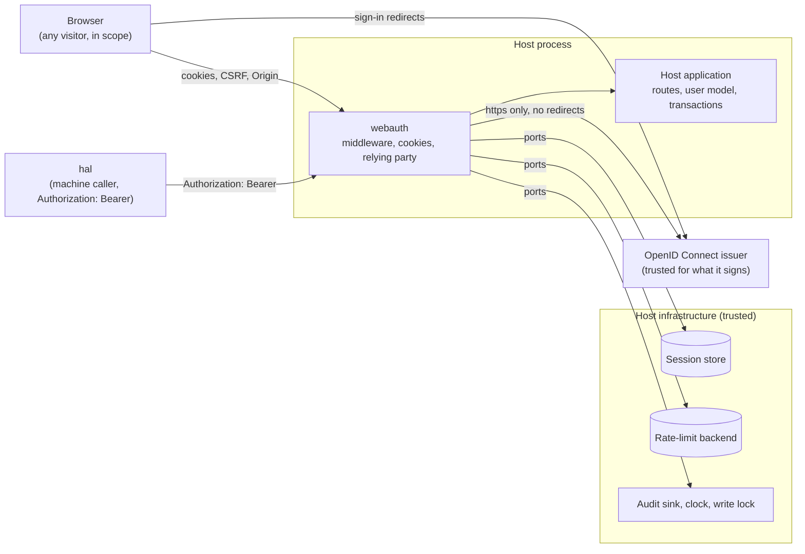

# webauth architecture

## Context and Scope

For an engineer changing the library; a host developer starts at the [README](../README.md). webauth is a library that a FastAPI host installs; it has no deployment
of its own and runs inside the host's process. It reads the host's one `WebAuthConfig`, calls the host's stores through the Protocols in `webauth.ports`, and talks
to the OpenID Connect issuer over https. The library persists nothing, holds no schema and no ORM, and writes no response except its own refusals.

## Building Blocks

The library owns the machinery an application should not rebuild:

| Module | Owns |
|---|---|
| `webauth.config` | The deployment facts every other module reads, installed on the app |
| `webauth.cookies` | The signed session cookie and the pending-login cookie, issued and cleared |
| `webauth.dependencies` | Turning a signed cookie, or a session id, into the account that made the request or opened a WebSocket handshake, and the record of a bearer admission the CSRF origin check and the session gate step aside for |
| `webauth.policies` | Which requests are exempt, cacheable, or rate-limited, how, and which `azp` values (`AuthorizedParties`) a host admits |
| `webauth.proxies` | Which peers may name a client, and the client identity that follows |
| `webauth.rate_limit` | The sliding-window backends a per-address budget is measured with, Redis or in-process |
| `webauth.ports` | What the host supplies, as Protocols, `AuthenticatedUser`, which the library hands out, and `BearerCaller`, the machine a bearer admission names |
| `webauth.middleware` | Body-size, CSRF, rate-limit, security-header, bearer-gate and session-gate middleware, and `install_web_auth_middleware`, which installs them in the one order |
| `webauth.jwt_verification` | Whether an RS256 token from a remote issuer holds, against the issuer's cached key set |
| `webauth.https_client` | The one owner of outbound HTTPS: the key-set fetch and the token-request form POST |
| `webauth.oidc` | Logging a browser in at an OpenID Connect issuer: the authorization URL with PKCE, the callback judged, the code exchanged, the ID token verified, an access token presented to the app verified, and the refresh and client-credentials grants |
| `webauth.oidc_login` | The login from the host's routes: admission and role, `open_session`, `log_out`, `fresh_access_token` and `receive_backchannel_logout` |
| `webauth.oidc_transport` | `post_token_request_over_https`, the production `TokenRequestPost` |

It leaves the application everything that touches the application's own truth:

- **Users and roles.** It has no user model and no role names beyond the configured ones; the one thing it writes to an
  account is the role admission derives from the issuer's groups, and it decides no authorisation beyond the admin check.
- **Transactions.** The library commits nothing. Whether a request that fails leaves the auth machinery's writes behind is
  the host's: a transaction that rolls back on an exception leaves none, a store that applies each call keeps them, and the
  rate-limit budget counts attempts either way. Behind [the session gate](#the-session-gate), the renewal is durable before
  the route runs.
- **Routes.** It defines none. The only responses it writes are its own refusals: 401, 403, 413, 429, 503 and the 500, the
  302 to the host's login path, and the logout page `log_out` builds, which the host's logout route returns.
- **Identity.** It issues no access or ID tokens: it is no identity provider, and it verifies the ID tokens an issuer made and the access tokens presented on a host's machine paths.
- **HTTP framing** is the ASGI server's job. uvicorn's two parsers, h11 and httptools, answer some framing conflicts
  differently, and HTTP allows either answer. webauth never re-parses framing: its body-size limit counts the streamed bytes
  whatever the headers say.

## Runtime View

### The store decides every request

The library caches no sessions: `SessionRecordStore` is asked on every authenticated request, so a session the host ended is refused on its next one. The library
alone decides whether a loaded session still stands; the store writes the expiry it is given.

### Middleware order

`install_web_auth_middleware` adds the library's middleware in one order, outermost first, and refuses a stack that would break it: security headers, body size
limit, per-address rate limit, bearer gate, CSRF origin, session gate. Install it once and add no library middleware yourself. Its docstring holds the reason for each
position and where a host's own middleware goes. A host whose own middleware is the session authority answers a request without a session with
`webauth.dependencies.unauthenticated_response`.

### The bearer gate

`install_web_auth_middleware(..., bearer_gate=BearerGate(...))` declares the host's machine paths once. On every request a path selects (written as `PathRules` says, every method), the gate verifies that request's own `Authorization: Bearer` token with `OidcRelyingParty.verify_access_token` (off the event loop):
an RS256 `at+jwt` of the issuer whose only `aud` is the app's client, whose `azp` is among `AuthorizedParties`, and whose `groups` give `AppRole.ADMIN` as at login.
Nothing is provisioned. Only then does it record an admission for this app, this path and a SHA-256 digest of the one header value; the digest lives in request
memory and the token is never stored. `CsrfOriginMiddleware` and the session gate read that record strictly and step aside, so no cookie decides
a machine path; `bearer_caller` reads it strictly too, and the loose reader makes `current_user` and `admitted_admin` raise (500) and `admitted_user` answer `None`. A copy of the record
carried to another path, app or header is no admission. The gate sits inside the rate limit, so a bearer request spends the same budget, and the installer puts a
`no-store` rule first in the security-headers policy for the gated paths, so every answer there is `no-store`, and webauth sets no cookie there. The README holds the refusal table.

### Reading the session

`current_user_dependency` binds the host's session store into the route dependencies `current_user`, `admin_user` and `verified_session_id`. A missing or dead
session answers 401, or, for a browser navigation on a server-rendered host that names a `LoginRedirect`, a redirect to its login page. `session_id_from_request`
reads the signed session cookie and `admit_session` decides a session id that the host read itself.

### The session gate

`install_web_auth_middleware(..., session_gate=SessionGate(...))` makes the rule of "Signed out and refused" hold for every route: a request needs a live session
unless the host names it, so a route that forgets a dependency is gated, not public. `admitted_user` reads the gate's admission where no dependency is used, and `admitted_admin` adds the admin check to that reading.

### WebSocket handshakes

A browser sends the session cookie on a cross-site WebSocket handshake too. `authenticate_websocket` is the one check a host runs at the handshake: it decides the
`Origin` first, then the session. A socket does not end when its session does, so the host checks again while it streams.

### The return path

The path a person was headed to travels through the login as `return_to`. Only a same-origin path of this app comes back from `finish_login`; anything else comes
back as `None`, the host's default page, and the login still succeeds. The `start_login` docstring holds the rule.

### Logging out and the ID token hint

`log_out` is the whole logout sequence in one call: it ends the session, clears the cookies and answers a `no-store` page that POSTs the client ID, the post-logout
redirect URI and the ID token hint to the issuer's end-session endpoint and submits itself, so the issuer ends its own session too and no URL carries the token.
Where a script cannot run, the page shows one button. The page carries its own Content-Security-Policy, which admits only its one script by hash and posts only to
the end-session and post-logout origins, and the security-headers middleware leaves that policy and its `Cache-Control` in place ([Trust](#trust)). It makes
no outbound call, so an issuer that is down still leaves the person signed out of the app. Its docstring holds the rest.

The login's ID token lives in the session row, next to the refresh token, and ends with it; the browser holds no copy. `open_session` stores it unless the host keeps none (`keeps_id_token=False`, for a host that never logs out), `log_out` reads it from
the row it is about to delete, whatever the row's lifetime says, and passes it to Keycloak as `id_token_hint`, so Keycloak can end its session without asking the person
to confirm. The hint is never a credential: webauth does not sign, decode, verify or log it, and Keycloak judges it. A logout after the row is gone (ended by the host,
swept, pruned, ended by back-channel logout, or stored before the host held ID tokens) sends no hint, and Keycloak asks once while its own session lives. Renewing a
session and rotating its refresh token leave the login's token as it was.

### Back-channel logout

When a person's session ends at the issuer, the issuer posts a Logout Token to every client that session signed in to.
`webauth.oidc_login.receive_backchannel_logout` reads that form, has `OidcRelyingParty.verify_logout_token` check the token, and ends every session of its subject,
in every browser. The host owns the route and the transaction; the route answers 200 only after its commit. The token's signature is the only control, so the route
must be reachable by the issuer alone. The docstrings of those two names hold the token rules and the setup the route needs.

### The relying party

`webauth.oidc.OidcRelyingParty` runs the authorization-code flow with PKCE for one client at one issuer, described by an `OidcClientConfig` that the host builds with
its secrets from its own secret channel. Every outbound call goes through the two transports the host injects (`webauth.oidc_transport.post_token_request_over_https`
and `webauth.https_client.fetch_key_set_over_https`), which speak https only, bound every request in time and size, follow no redirect and log nothing. The host
names the issuer's authorization, token, key-set and end-session URLs itself; the library does no discovery.

### The person's access token

`webauth.oidc_login.fresh_access_token` turns a signed-in session into a new access token for one call to another service, in memory only. It answers a `SecretStr`,
or an `AccessTokenRefusal` whose `AccessTokenRefusalReason` says what the host does. A token handed out stays valid until its own `exp` after a later logout, and
webauth makes no revocation call ([Trust](#trust), item 8). `OidcRelyingParty.workload_access_token` answers the client's own token.

### Admitting an identity

`admit_identity` turns a verified identity into the account it signs in as, and `finish_login` takes the same `AdmissionConfig`. The host's store is bound to one
issuer, so an account's `id` is the issuer's subject. Members of `login_group` come in, members of `admin_group` get the admin role, and `EverySubject` and
`NoAdmins` state on purpose that there is no group to require or no admin. A second service that verifies the issuer's token itself calls `app_role`.

## Crosscutting Concepts

### Configuration

The host builds one `WebAuthConfig` by keyword and installs it with `install_web_auth_config`; no module reads an environment variable or a global. Its docstring
says what each field decides and what construction refuses. `cookie_secure` is the one switch for transport security: it alone decides whether the session cookie carries
`Secure` and whether HSTS is sent, whatever the request's scheme, so a host serving plain http (local development) turns it off for that environment and nowhere
else. `SecurityHeadersPolicy` names the headers every response carries, the library's own refusals and the 500 among them, and `default_content_security_policy()`
builds the policy a host gives it.

### Session lifetime

`SessionLifetime` holds the two numbers that decide how long someone stays signed in: an idle window and an absolute cap from the session's creation. An open session
is not re-checked, so the cap is also the worst-case delay before a removal from the host's login group takes effect. The recommended policy for a host that admits
by `login_group` is a 12-hour cap with an idle window of the same length. Every login checks the group again, and the issuer's SSO session turns that login into a
redirect the person does not notice. A removal takes effect at once only by disabling the user at the issuer together with [Back-channel
logout](#back-channel-logout).

### CSRF origin

`CsrfOriginMiddleware` refuses a state-changing request that a foreign page originated, by `Sec-Fetch-Site` where a browser sends it and otherwise by comparing
`Origin` with the hostnames in `WebAuthConfig`; a state-changing request with neither header is refused; a request the bearer gate admitted is not checked, because those routes ignore ambient cookies and need an explicitly supplied credential; the `WebAuthConfig` docstring holds the matching rule. `CsrfPolicy` names what it exempts: every other state-changing path is checked.

webauth supports the current releases of Chrome, Edge, Firefox and Safari (macOS and iOS). On every request whose method is not GET or HEAD, each sends `Origin`, possibly `null`, and, to an https app, `Sec-Fetch-Site`. A state-changing request that carries neither is refused, whatever its content type; `Referer` is not read.

### Rate limiting, and the optional Redis extra

`WebAuthConfig.rate_limits` is a `webauth.ports.RateLimitBackend`, and the host names its budgets in a `webauth.policies.RateLimitPolicy`. A backend that cannot
answer raises, so the middleware fails the request closed. `webauth.rate_limit.RedisRateLimitBackend` shares one window across processes and needs the optional
extra, `overnightworks-webauth[redis]`; `webauth.rate_limit.SingleProcessRateLimitBackend` serves a single-node host that runs one worker and needs no Redis.

### Audit events

The library reports an account operation (a user created, a role changed, a back-channel logout) to the host's `AuditSink.account_event`, which maps it to the host's
audit system or does nothing. An event carries no session identifier or username.

### Trust

Who the library defends against, and what it trusts. Where a line has an
owning section, it links there.

1. **Browser to library** (cookies, [CSRF](#csrf-origin), Origin, [return path](#the-return-path), body size, [the session gate](#the-session-gate), [rate limit](#rate-limiting-and-the-optional-redis-extra), [WebSocket handshake](#websocket-handshakes)): any browser or cross-site attacker is in scope. A network attacker below TLS is out of scope; the host's TLS, HSTS and `cookie_secure` own that ([Configuration](#configuration)).
2. **Library to issuer:** the configured issuer is trusted for what it signs and serves over TLS, and gets no defence beyond the JOSE and OpenID Connect specifications and PyJWT.
   - In scope: anyone presenting a token that lacks the issuer's signature or carries the wrong `alg`, `aud`, `iss`, type or time.
   - In scope: a network attacker against TLS. The library speaks https only, verifies the issuer's certificate against the system's trusted CAs and follows no redirect ([The relying party](#the-relying-party)).
   - Availability: every connection and read is bounded.
3. **Host configuration to library:** the host developer and the operator are trusted but fallible. The library checks the values whose mistake would silently weaken security or stick: secret length, the bools behind `Secure` and HSTS, a single string where a collection belongs, https URLs, group paths, ranges, and structure-breaking characters. It does not re-check a type that pyright proves unless the wrong type would pass construction silently, nor a grammar the browser already parses fail-closed. An answer that carries the private marker header `webauth-own-policy` keeps its own Content-Security-Policy and `Cache-Control`, and the security-headers middleware removes the marker: only `log_out`'s page sets it, host code is trusted, and no library path copies a request header into an answer, so no browser can set it. A host that relays another server's response headers would relay that server's marker too; without the middleware the page still carries its own policy and the marker reaches the browser, which ignores it.
4. **Host store to library (ports):** the store is trusted to keep its Protocol docstring duties ([`webauth.ports`](../src/webauth/ports.py)): id entropy, exact comparison, atomicity, and raising on a missing row. The library re-derives every decision it owns from the record's fields, so a wrong `expires_at` is refused ([Session lifetime](#session-lifetime)). It does not detect a store that breaks a duty. The store holds the session's refresh token in plain text, and a dump of it holds no credential usable on its own: the issuer renews it only with the client secret. It also holds the login's ID token (unless the host keeps none), which is the person's identity claims and no credential, but whose copy lets its holder end that Keycloak session without asking.
5. **Host infrastructure** (`WallClock`, `WriteLock`, Redis, the logging pipeline): trusted. The library itself never logs a token, secret, cookie or session id, and keeps urllib3 from logging during its exchanges.
6. **The back-channel logout route:** anyone who can reach it is untrusted. The token signature is the control; reachability is the host's duty ([Back-channel logout](#back-channel-logout)).
7. **Bearer caller to library** ([The bearer gate](#the-bearer-gate)): anyone who can reach a gated path is untrusted. The token's signature, issuer, type, audience, `azp` and groups are the control; the admission record keeps a SHA-256 digest of the header in request memory, never the token. Named residues:
   - a block at the issuer reaches the gate only when the token expires, plus the leeway;
   - a browser sign-out leaves the token valid;
   - an admin token opens every machine route; there is no sender constraint (no DPoP or mTLS);
   - only the realm keeps a service account out of the admin group;
   - an unavailable key set answers 401, not 503;
   - WebSocket scopes are not gated;
   - host code that reads the cookie itself (`session_id_from_request`) on a machine path trusts it.
8. **Named residues:**
   - the ID token reaches the browser only in the one `no-store` logout answer; what a browser's session restore keeps of a `no-store` page is the browser's, and a same-origin script reads the hint only by posting the logout itself, which ends the session;
   - with a `WriteLock` that is released before the host commits (an in-process lock), a back-channel logout of the same account that runs between `finish_login`'s admission and the host's commit after `open_session` deletes nothing of that login, so the session it opens survives; a lock that the request's first `hold` takes and only the host's commit or rollback releases (a transaction-scoped lock) closes that window;
   - a node whose clock runs more than 60 s behind the node that last renewed a session, or a clock that steps back more than 60 s, refuses that session until its clock catches up; the session is not ended ([Session lifetime](#session-lifetime));
   - a clock reading past year 9999 fails closed;
   - name resolution is bounded by the system resolver, not by the library; connecting is bounded per resolved address, outside the total deadline ([The relying party](#the-relying-party));
   - an access token that [`fresh_access_token`](#the-persons-access-token) handed out stays valid at the service it is sent to, and at the issuer's own endpoints, until its own `exp`, even after a logout or an expiry that lands once the call has decided; webauth revokes nothing;
   - a copy of a logout token replays within its age bound (`LOGOUT_TOKEN_MAX_AGE_SECONDS` plus the leeway), so it ends the sessions of a login made after the first delivery; webauth keeps no `jti` store, as the `webauth.oidc` module docstring says;
   - with a store that commits every statement, a session deleted between `fresh_access_token`'s second `load` and the end of its block is seen only through `replace_refresh_token` answering `False`, and an issuer that echoes or omits the refresh token never reaches that call, so the call then hands out a token for the session deleted in that window.

To report a vulnerability, see [SECURITY.md](../SECURITY.md).

The operator's account and environment are trusted. A same-user race between listing and removal in `scripts/e2e-oidc.sh` is out of scope.
