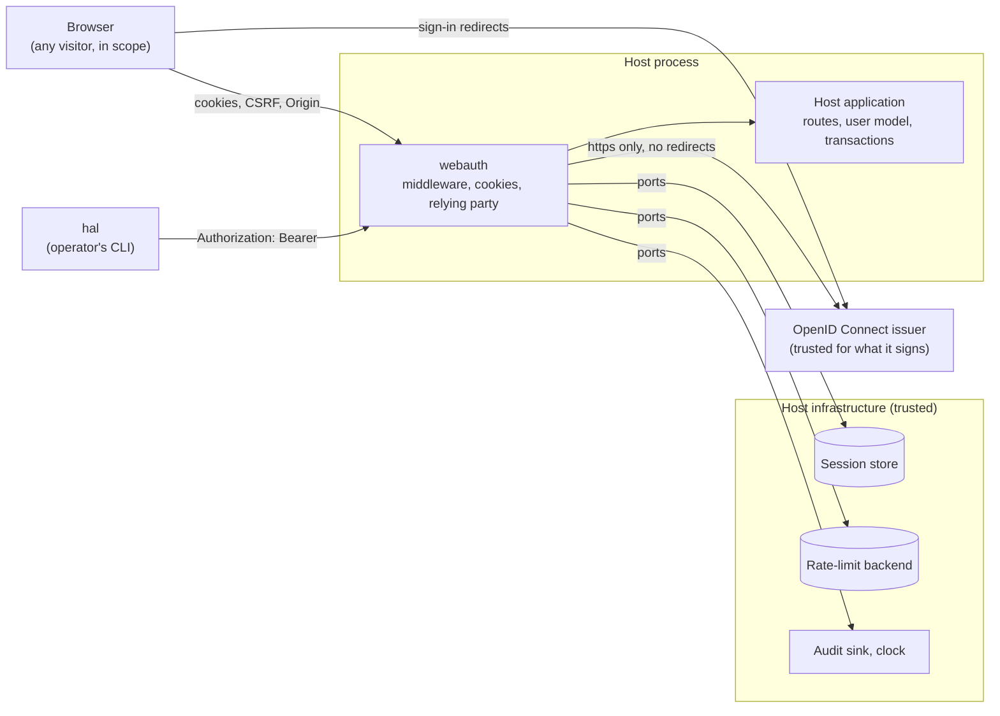
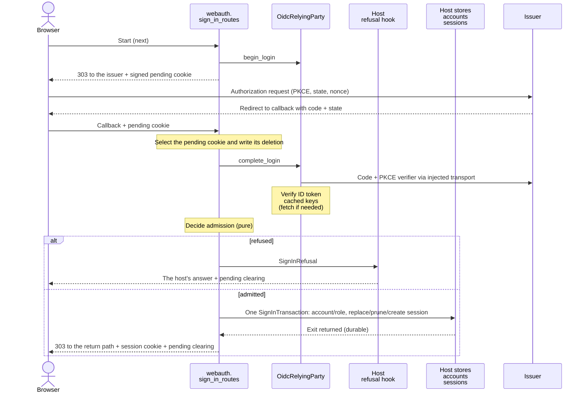

# webauth architecture

## Context and Scope

webauth runs inside a FastAPI host, with no deployment, schema or ORM. Host developers start at the [README](../README.md).

Request boundaries for the changing engineer, from [`middleware`](../src/webauth/middleware/), [`ports`](../src/webauth/ports.py),
[`oidc`](../src/webauth/oidc.py) and [`https_client`](../src/webauth/https_client.py).

## Building Blocks

Module owners in `webauth`: `oidc_login` coordinates admission, sessions, logout and fresh tokens.

- `sign_in_routes` registers the sign-in start, callback, logout and back-channel logout routes, selects `SignInPaths` policies and answers failures.
- `config` holds deployment facts; `policies` selects exemptions, caching, rate limits and admitted `AuthorizedParties`.
- `cookies` signs, issues and clears session/pending cookies; `dependencies` admits sessions and WebSocket users and records bearer admission (a machine caller, or on a person path the account behind the token).
- `middleware` enforces body size, CSRF, rate limits, security headers and bearer/session gates in one installed order.
- `proxies` derives client identity from trusted peers; `rate_limit` measures sliding windows in Redis or in process.
- `ports` defines host Protocols, `AuthenticatedUser` and `BearerCaller`; `jwt_verification` verifies RS256 against cached issuer keys.
- `oidc` owns authorization URLs, PKCE, callback/code/ID-token checks, access-token verification, refresh and client-credentials grants.
- `service_callers` is how a service proves the caller of its API: `ServiceCallerCheck.workload_caller` verifies an app's own token and returns the `WorkloadCaller`, and `person_caller` also binds a person's token to it and checks the person's membership, returning the `PersonCaller`; each returns the first `CallerRefusal` otherwise, under the service's `ServiceIdentity` and its registered apps; it holds no policy and logs nothing.
- `https_client` owns outbound HTTPS; `oidc_transport.post_token_request_over_https` implements the injected `TokenRequestPost`.

The host owns users/role names; the library writes the group-derived role and authorizes only the admin check.
The host owns transactions: rollback removes auth writes, per-call persistence keeps them; rate limits count attempts either way.
The sign-in callback, the logout route and the back-channel logout route each enter one host-owned `SignInTransaction`, serialized against every other entry over the same stores.
Session-gate renewal is durable before route execution. The library never commits or issues access/ID tokens.
The host owns its routes except the sign-in start, callback, logout and back-channel logout, which `install_sign_in_routes` registers; library responses are refusals (401/403/413/429/503/500), 302 login redirects, the sign-in 303s, the logout page and the back-channel's 200 and 400.
ASGI owns HTTP framing (h11/httptools may legally differ); the body-size limit counts streamed bytes, never re-parsing framing.

## Runtime View

Successful-login ownership for the changing engineer, from [`oidc_login`](../src/webauth/oidc_login.py), [`oidc`](../src/webauth/oidc.py),
[`jwt_verification`](../src/webauth/jwt_verification.py), [`cookies`](../src/webauth/cookies.py) and the [host callback](../tests/e2e/oidc/host_app.py).
The harness opens one sign-in transaction under its write lock around the account and session writes; cookies follow ([Trust](#trust)).
[Host refusals](host-contract.md#signed-out-and-refused) are outside this successful flow.

### The store decides every request

Every authenticated request reads `SessionRecordStore`, never a cache; the library judges validity, the store writes supplied expiry.

### Middleware order

`install_web_auth_middleware` enforces outermost-first: security headers, body size, rate limit, bearer gate, CSRF origin, session gate.
Install once, adding no library middleware yourself; its docstring explains placement of host middleware and rejected stacks.

### The bearer gate

[Host requirements/outcomes](host-contract.md#the-hosts-machine-routes), the [person paths](host-contract.md#the-persons-token-on-the-apps-api) and [refusals](host-contract.md#signed-out-and-refused) have one owner.
The gate runs `OidcRelyingParty.verify_access_token` off-loop, then `app_role`; only admission records app/path/header SHA-256 in request memory, never the token.
On a machine path the record holds a `BearerCaller`. On a person path (`PersonPaths`) the gate admits the account behind the token with the sign-in's own `app_role` and account step in one `SignInTransaction` entry, off-loop, and records an `AuthenticatedUser`; a request with no bearer credential falls through to the cookie. A path both rules select is a machine path.
CSRF, session gate, `bearer_caller`, `current_user` and `admitted_user` read strictly: another app/path/header is no admission. `session_id_from_request` and the loose reader refuse more: a bearer-admitted request names no session.
The gate sits inside rate limiting; installation puts its paths' `no-store` rule first in security-header policy.

### Reading the session

`current_user_dependency` binds the store to `current_user`, `admin_user`; `admit_session` judges a host-read id.
`session_id_from_request` reads the signed cookie; [the host contract](host-contract.md#signed-out-and-refused) owns `LoginRedirect`/401 outcomes.

### The session gate

`SessionGate` enforces [the host contract](host-contract.md#signed-out-and-refused) without route dependencies;
`admitted_user` reads admission, `admitted_admin` checks admin too.

### WebSocket handshakes

`authenticate_websocket` checks Origin before session: cross-site handshakes carry cookies too. The host rechecks while streaming;
ending a session alone does not end a socket.

### The return path

The return path survives login only as a same-origin app path, else the app root without refusal; the start route owns validation,
[the host contract](host-contract.md#signed-out-and-refused) owns the landing outcome.

### Logging out and the ID token hint

The logout route reads the row's ID token before deleting the session, in one `SignInTransaction` entry and only when the cookie names a session, even for expired rows; it neither renews nor admits.
It builds an end-session form without an outbound call. CSP admits one script by hash and only the end-session/post-logout origins;
security headers preserve that policy and `Cache-Control`. [The host contract](host-contract.md#what-every-app-gets) owns outcomes and ruling/proof provenance.
[Retention](host-contract.md#the-sign-in-routes) is explicit. webauth never signs, decodes, verifies or logs the hint;
Keycloak judges it. [Trust](#trust), items 4 and 9, owns exposure and copied-token consequences.

### Back-channel logout

`install_sign_in_routes` registers the issuer's route for `POST` only, over a private step. It reads the body outside every catch (a streamed oversized body is 413), verifies the form's one `logout_token` through `OidcRelyingParty.verify_logout_token`, and only then enters one `SignInTransaction`, where it deletes the subject's sessions and records one event when at least one session ended. A refused form or token is an empty 400 that enters no transaction; 200 follows only a clean exit; any exception in the relying-party callable, the verification, a store, the audit sink or the exit is an empty 400 and is re-raised. The host's `backchannel_dependencies` run before the body is read and answer its own 404 by exception handler.
The host's transaction rolls back when the block raises, also when the audit sink fails after the deletion. Signature is the only control; restrict reachability to the issuer.

### The relying party

`OidcRelyingParty` runs authorization-code/PKCE for one client/issuer, using host-built `OidcClientConfig` and host secret channels.
Injected `oidc_transport.post_token_request_over_https` and `https_client.fetch_key_set_over_https` bound time/size, use HTTPS,
follow no redirects and log nothing. The host names authorization, token, key-set and end-session URLs; there is no discovery.

### The person's access token

`fresh_access_token` takes a session and returns a `SecretStr` in memory, or `AccessTokenRefusal` carrying `AccessTokenRefusalReason`.
`OidcRelyingParty.workload_access_token(scopes=...)` returns the client's token for the scopes the host passes, the callee's audience scope; [Trust](#trust), item 9, owns lifetime after logout.

### Admitting an identity

The callback's admission decision and its account write share `AdmissionConfig`; the host store binds to one issuer, whose subject is the account `id`.
`app_role` owns the [group decision](host-contract.md#what-every-app-gets), also used by services verifying issuer tokens themselves.

## Crosscutting Concepts

### Configuration

The host installs one keyword-built `WebAuthConfig` via `install_web_auth_config`; no module reads environment variables or globals.
`cookie_secure` alone controls cookie `Secure`/HSTS regardless of request scheme; disable only for plain-HTTP development. Its docstring owns checks.
`SecurityHeadersPolicy` covers all responses, refusals/500 included; `default_content_security_policy()` builds its policy.

### Session lifetime

`SessionLifetime` bounds idle time and total time since creation. Groups are not rechecked during a session;
[the host contract](host-contract.md#what-every-app-gets) owns membership/role changes. For `login_group`, both recommended windows are 12 hours.

### CSRF origin

`CsrfOriginMiddleware` applies [host rules](host-contract.md#csrf-origin): Fetch Metadata, then the origin matcher WebSocket checks use directly.
Verified bearer admission bypasses it; `CsrfPolicy` selects exemptions, `WebAuthConfig` owns exact-host/port matching.

### Rate limiting, and the optional Redis extra

`WebAuthConfig.rate_limits` supplies `RateLimitBackend`; `RateLimitPolicy` sets budgets. Backend errors fail closed.
`RedisRateLimitBackend` shares windows across processes and needs `[redis]`; `SingleProcessRateLimitBackend` needs no Redis, for one worker only.

### Audit events

`AuditSink.account_event` reports user creation, role changes and back-channel logout, with no session id/username; the host maps it or does nothing.

### Trust

Who the library defends against and trusts; links point to owning sections.

1. **Browser to library** (cookies, [CSRF](#csrf-origin), Origin, [return path](#the-return-path), body size, [the session gate](#the-session-gate), [rate limit](#rate-limiting-and-the-optional-redis-extra), [WebSocket handshake](#websocket-handshakes)): any browser or cross-site attacker is in scope. A network attacker below TLS is out of scope; the host's TLS, HSTS and `cookie_secure` own that ([Configuration](#configuration)).
2. **Library to issuer:** the configured issuer is trusted for what it signs and serves over TLS, and gets no defence beyond the JOSE and OpenID Connect specifications and PyJWT.
   - In scope: anyone presenting a token that lacks the issuer's signature or carries the wrong `alg`, `aud`, `iss`, type or time.
   - In scope: a network attacker against TLS. The library speaks https only, verifies the issuer's certificate against the system's trusted CAs and follows no redirect ([The relying party](#the-relying-party)).
   - Availability: every connection and read is bounded.
3. **Host configuration to library:** the host developer and the operator are trusted but fallible. The library checks the values whose mistake would silently weaken security or stick: secret length, the bools behind `Secure` and HSTS, a single string where a collection belongs, https URLs, group paths, ranges, and structure-breaking characters. It does not re-check a type that pyright proves unless the wrong type would pass construction silently, nor a grammar the browser already parses fail-closed. An answer that carries the private marker header `webauth-own-policy` keeps its own Content-Security-Policy and `Cache-Control`, and the security-headers middleware removes the marker: only the logout route's page sets it, host code is trusted, and no library path copies a request header into an answer, so no browser can set it. A host that relays another server's response headers would relay that server's marker too; without the middleware the page still carries its own policy and the marker reaches the browser, which ignores it.
4. **Host store to library (ports):** the store is trusted to keep its Protocol docstring duties ([`webauth.ports`](../src/webauth/ports.py)): id entropy, exact comparison, atomicity, serialization of sign-in entries, and raising on a missing row. The library re-derives every decision it owns from the record's fields, so a wrong `expires_at` is refused ([Session lifetime](#session-lifetime)). It does not detect a store that breaks a duty. The store holds the session's refresh token in plain text, and a dump of it holds no credential usable on its own: the issuer renews it only with the client secret. An ID token stored there carries the person's identity claims, not an authentication credential; a copy nevertheless allows its holder to invoke the [hinted logout](host-contract.md#what-every-app-gets).
5. **Host infrastructure** (`WallClock`, Redis, the logging pipeline): trusted. The library itself never logs a token, secret, cookie or session id, and keeps urllib3 from logging during its exchanges.
6. **The back-channel logout route:** anyone who can reach it is untrusted. The token signature is the control; reachability is the host's duty ([Back-channel logout](#back-channel-logout)).
7. **Bearer caller to library:** anyone who can reach a gated path is untrusted. [The bearer gate](#the-bearer-gate) owns the verification and admission mechanism; the [host contract](host-contract.md#the-hosts-machine-routes) owns token lifetime, cookie handling and socket exclusions. Named residues:
   - an admin token opens every machine route; there is no sender constraint (no DPoP or mTLS);
   - on a person path a token is the person, with their rights and no layer on top, until its `exp` plus leeway: a browser sign-out, a back-channel logout or disabling the person at the issuer does not end it, group changes arrive with the next token, and a copied token is the person;
   - every token request on a person path enters the host's serialized `SignInTransaction` and shares the address budget with the browser;
   - only the realm keeps a service account out of the admin group;
   - key-set unavailability fails verification; its response is in [Signed out and refused](host-contract.md#signed-out-and-refused).
8. **A service's caller:** anyone who can reach a service's API is untrusted. [`service_callers`](../src/webauth/service_callers.py) owns the workload proof (realm role, `azp` equal to `client_id`, a registered client, a bounded token life) and the person binding (the person's `azp` is the workload's, another subject, a member of the app) and refuses 401 and 503 causes before any 403 ([host contract](host-contract.md#a-services-callers)). Replay of an app's token between services is closed only while each app requests the callee's audience alone in each workload grant and no service holds an app's credentials. Named residues:
   - a compromised app credential defeats that protection;
   - `account` stays in `aud` of tokens as the realm issues them;
   - the check proves who the app is, not what the service lets it do: groups, roles, routing and wire codes belong to the service.
9. **Named residues:**
   - the ID token reaches the browser only in the one `no-store` logout answer; what a browser's session restore keeps of that page is the browser's, and a same-origin script reads the hint only by posting the logout itself, which ends the session;
   - a logout that completes before a verified sign-in cannot end that later session; closing that needs sessions bound to the issuer's `sid`, which webauth does not do. A failed sign-in is not repaired later: a host whose store applies each call keeps the account created, the sessions ended and the events recorded before the failure;
   - a node whose clock runs more than 60 s behind the node that last renewed a session, or a clock that steps back more than 60 s, refuses that session until its clock catches up; the session is not ended ([Session lifetime](#session-lifetime));
   - a clock reading past year 9999 fails closed;
   - name resolution is bounded by the system resolver, not by the library; connecting is bounded per resolved address, outside the total deadline ([The relying party](#the-relying-party));
   - an access token that [`fresh_access_token`](#the-persons-access-token) handed out stays valid at the service it is sent to, and at the issuer's own endpoints, until its own `exp`, even after a logout or an expiry that lands once the call has decided; webauth revokes nothing;
   - a copy of a logout token replays within its age bound (`LOGOUT_TOKEN_MAX_AGE_SECONDS` plus the leeway), so it ends the sessions of a login made after the first delivery; webauth keeps no `jti` store, as the `webauth.oidc` module docstring says;
   - with a store that commits every statement, a session deleted between `fresh_access_token`'s second `load` and the end of its block is seen only through `replace_refresh_token` answering `False`, and an issuer that echoes or omits the refresh token never reaches that call, so the call then hands out a token for the session deleted in that window.

To report a vulnerability, see [SECURITY.md](../.github/SECURITY.md).

The operator's account and environment are trusted. A same-user race between listing and removal in `scripts/run_oidc_proof.sh` is out of scope.
