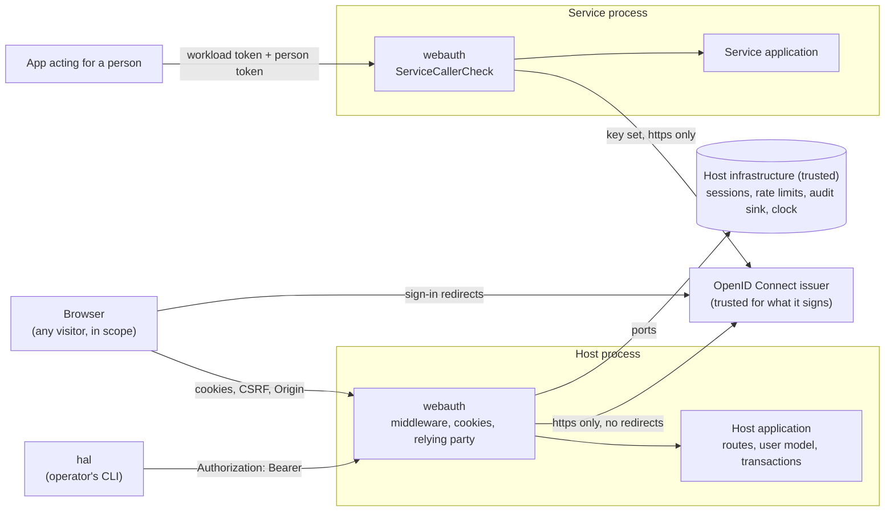
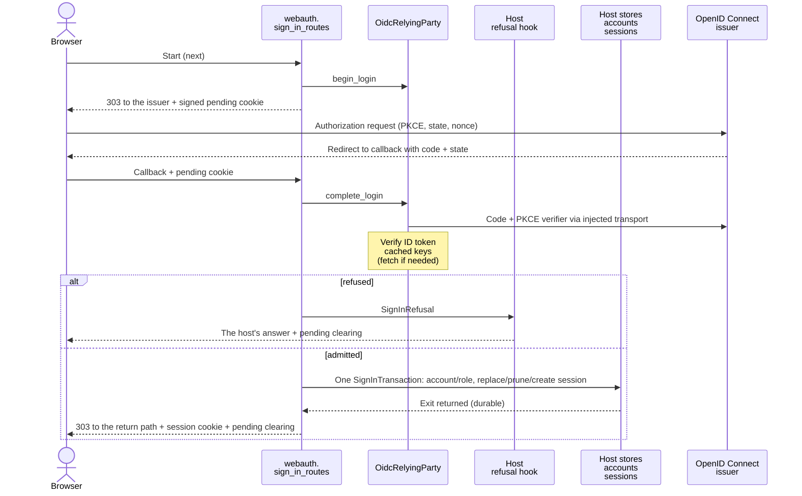

# webauth architecture

## 1. Context and Scope

webauth runs inside a FastAPI host, with no deployment, schema or ORM. Host developers start at the [README](../README.md).

Request boundaries for the changing engineer, from [`middleware`](../src/webauth/middleware/), [`ports`](../src/webauth/ports.py), [`oidc`](../src/webauth/oidc/), [`service_callers`](../src/webauth/service_callers.py) and [`https_client`](../src/webauth/https_client.py).

## 2. Building Block View

Module owners in `webauth`: `oidc_login` coordinates admission, sessions, logout and fresh tokens.

- `sign_in_routes` registers the sign-in start, callback, logout and back-channel logout routes, selects `SignInPaths` policies and answers failures.
- `admission` decides who gets in and as which `AppRole`, from the groups and an `AdmissionConfig`, with no I/O; `oidc_login` and the bearer gate apply it and services call `app_role`.
- `config` holds deployment facts; `policies` selects exemptions, caching, rate limits and admitted `AuthorizedParties`.
- `cookies` signs, issues and clears session/pending cookies; `dependencies` admits sessions and WebSocket users and records bearer admission.
- `middleware` enforces body size, CSRF, rate limits, security headers and bearer/session gates in one installed order.
- `proxies` derives client identity from trusted peers; `rate_limit` measures sliding windows in Redis or in process.
- `ports` defines host Protocols, `AuthenticatedUser` and `BearerCaller`; `jwt_verification` verifies RS256 against cached issuer keys.
- `oidc` owns authorization URLs, PKCE, callback/code/ID-token checks, access-token verification, refresh and client-credentials grants.
- `service_callers` is how a service proves the caller of its API ([host contract](host-contract.md#a-services-callers)); it holds no policy and logs nothing.
- `https_client` owns outbound HTTPS; `oidc_transport.post_token_request_over_https` implements the injected `TokenRequestPost`.

The host owns users; webauth owns the role names (`AppRole`), writes the group-derived role and authorizes only the admin check.
The host owns transactions: rollback removes auth writes, per-call persistence keeps them; rate limits count attempts either way.
The sign-in callback, the logout route and the back-channel logout route each enter one host-owned `SignInTransaction`, serialized against every other entry over the same stores. Session-gate renewal is durable before route execution. The library never commits or issues access/ID tokens.
The host owns its routes except the four `install_sign_in_routes` registers; [the library's responses](host-contract.md#signed-out-and-refused) are in the host contract.

## 3. Runtime View

Successful-login ownership for the changing engineer, from [`oidc_login`](../src/webauth/oidc_login.py), [`oidc`](../src/webauth/oidc/), [`jwt_verification`](../src/webauth/jwt_verification.py), [`cookies`](../src/webauth/cookies.py) and the [host callback](../tests/e2e/oidc/host_app.py).

### The store decides every request

Every authenticated request reads `SessionRecordStore`, never a cache ([`ports`](../src/webauth/ports.py) owns the duties); the library judges validity.

### The bearer gate

The gate verifies the bearer with `OidcRelyingParty` off-loop and admits by the kind of path (machine, person, protected resource), each with its own `AuthorizedParties`; the resource's agent group admits an agent's own client beyond them.
[The host contract](host-contract.md#the-hosts-machine-routes) owns the outcomes; `no-store` and the selection order are in [the person paths](host-contract.md#the-persons-token-on-the-apps-api) and [the protected resource](host-contract.md#the-protected-resource).

### Reading the session

`current_user_dependency` binds the store to `current_user`, `admin_user`; `admit_session` judges a host-read id. `session_id_from_request` reads the signed cookie; [the host contract](host-contract.md#signed-out-and-refused) owns `LoginRedirect`/401 outcomes.

### The session gate

`SessionGate` enforces [the host contract](host-contract.md#signed-out-and-refused) without route dependencies; `admitted_user` reads admission, `admitted_admin` checks admin too.

### WebSocket handshakes

`authenticate_websocket` checks Origin before session: cross-site handshakes carry cookies too. The host rechecks while streaming; ending a session alone does not end a socket.

### The return path

The return path survives login only as a same-origin app path, else the app root without refusal; the start route owns validation, [the host contract](host-contract.md#signed-out-and-refused) owns the landing outcome.

### Logging out and the ID token hint

The logout route reads the row's ID token before deleting the session and builds an end-session form without an outbound call;
[the host contract](host-contract.md#what-every-app-gets) owns the outcomes and [retention](host-contract.md#the-sign-in-routes) is explicit.
webauth never signs, decodes, verifies or logs the hint; Keycloak judges it. [Trust](#trust) and [Risks](#8-risks-and-technical-debt) own exposure and copied-token consequences.

### Back-channel logout

`install_sign_in_routes` registers the issuer's route for `POST` only; it verifies the form's `logout_token` before it enters one `SignInTransaction` that deletes the subject's sessions. [The host contract](host-contract.md#the-sign-in-routes) owns the answers.

### Admitting an identity

The callback's admission decision and its account write share `AdmissionConfig`; the host store binds to one issuer, whose subject is the account `id`. `app_role` owns the [group decision](host-contract.md#what-every-app-gets), also used by services verifying issuer tokens themselves.
`OidcRelyingParty` runs authorization-code/PKCE for one client and issuer from host-built `OidcClientConfig`; the host names every URL, and there is no discovery.

## 4. Deployment View

webauth has no deployment of its own: each host runs it in its own process at a git-pinned tag ([Install](../README.md#install)).
Rate-limit windows shared across processes need the `redis` extra ([Rate limiting](#rate-limiting-and-the-optional-redis-extra)).
The proof harness runs by hand on the operator's machine, in Docker, on free loopback ports ([runbooks](runbooks/run-the-browser-proof.md)).
The operator's account and environment are trusted. A same-user race between listing and removal in `scripts/run_oidc_proof.sh` is out of scope.

## 5. Crosscutting Concepts

### Session lifetime

`SessionLifetime` bounds idle time and total time since creation. Groups are not rechecked during a session; [the host contract](host-contract.md#what-every-app-gets) owns membership/role changes. For `login_group`, both recommended windows are 12 hours.

### Rate limiting, and the optional Redis extra

`WebAuthConfig.rate_limits` supplies `RateLimitBackend`; `RateLimitPolicy` sets budgets. Backend errors fail closed. `RedisRateLimitBackend` shares windows across processes and needs `[redis]`; `SingleProcessRateLimitBackend` needs no Redis, for one worker only.

### Proof strategy

CI's `checks` job runs `scripts/run_static_checks.sh` (ruff, format, deptry, pyright, the typing hosts against the built wheel), `pytest tests` with branch coverage and the hash-pinned build;
`lowest-direct` runs the tests at the lowest declared versions with the `redis` extra; `quality / verdict` takes the coverage artifact, SonarCloud and the import contracts.
The browser proof (Chromium, Firefox and WebKit against a real Keycloak) and the OIDF conformance suite run by hand through `scripts/run_oidc_proof.sh` and the [runbooks](runbooks/run-the-browser-proof.md); CI only lints `tests/e2e/`.
The host contract names the test that proves each rule.

### Trust

1. **Browser to library** (cookies, [CSRF](host-contract.md#csrf-origin), Origin, [return path](#the-return-path), body size, [the session gate](#the-session-gate), [rate limit](#rate-limiting-and-the-optional-redis-extra), [WebSocket handshake](#websocket-handshakes)): any browser or cross-site attacker is in scope. A network attacker below TLS is out of scope; the host's TLS, HSTS and `cookie_secure` own that.
2. **Library to issuer:** the configured issuer is trusted for what it signs and serves over TLS, and gets no defence beyond the JOSE and OpenID Connect specifications and PyJWT.
   - In scope: anyone presenting a token that lacks the issuer's signature or carries the wrong `alg`, `aud`, `iss`, type or time.
   - In scope: a network attacker against TLS. The library speaks https only, verifies the issuer's certificate against the system's trusted CAs and follows no redirect.
   - The realm alone decides which clients can mint a token for an app's MCP audience; a protected resource's agent group lets a token of any such client past the party check, and the token's own claims (`agent_owner`, `agent_name`) then decide only who the agent says it is, not whether it is admitted.
3. **Host configuration to library:** the host developer and the operator are trusted but fallible. The library checks the values whose mistake would silently weaken security or stick: secret length, the bools behind `Secure` and HSTS, a single string where a collection belongs, https URLs, group paths, ranges, and structure-breaking characters. It does not re-check a type that pyright proves unless the wrong type would pass construction silently, nor a grammar the browser already parses fail-closed. An answer that carries the private marker header `webauth-own-policy` keeps its own Content-Security-Policy and `Cache-Control`, and the security-headers middleware removes the marker: only the logout route's page sets it, host code is trusted, and no library path copies a request header into an answer, so no browser can set it. A host that relays another server's response headers would relay that server's marker too; without the middleware the page still carries its own policy and the marker reaches the browser, which ignores it.
4. **Host store to library (ports):** the store is trusted to keep its Protocol docstring duties ([`webauth.ports`](../src/webauth/ports.py)): id entropy, exact comparison, atomicity, serialization of sign-in entries, and raising on a missing row. The library re-derives every decision it owns from the record's fields, so a wrong `expires_at` is refused ([Session lifetime](#session-lifetime)). It does not detect a store that breaks a duty. The store holds the session's refresh token in plain text, and a dump of it holds no credential usable on its own: the issuer renews it only with the client secret. An ID token stored there carries the person's identity claims, not an authentication credential; a copy nevertheless allows its holder to invoke the [hinted logout](host-contract.md#what-every-app-gets).
5. **Host infrastructure** (`WallClock`, Redis, the logging pipeline): trusted. The library itself never logs a token, secret, cookie or session id, and keeps urllib3 from logging during its exchanges.
6. **The back-channel logout route:** anyone who can reach it is untrusted. The token signature is the control; reachability is the host's duty ([Back-channel logout](#back-channel-logout)).
7. **Bearer caller to library:** anyone who can reach a gated path is untrusted. [The bearer gate](#the-bearer-gate) owns the mechanism and the [host contract](host-contract.md#the-hosts-machine-routes) owns token lifetime, cookie handling and socket exclusions; the residues are in [Risks](#8-risks-and-technical-debt).
8. **A service's caller:** anyone who can reach a service's API is untrusted. [`service_callers`](../src/webauth/service_callers.py) owns the workload proof and the person binding and refuses 401 and 503 causes before any 403 ([host contract](host-contract.md#a-services-callers)). Replay of an app's token between services is closed only while each app requests the callee's audience alone in each workload grant and no service holds an app's credentials.

To report a vulnerability, see [SECURITY.md](../.github/SECURITY.md).

## 6. Constraints and reasons

- The library never commits: durability belongs to the host, so each host decides what a failure keeps ([host contract](host-contract.md#the-sign-in-routes)).
- It caches no session: the store decides every request, so a session the host ended is refused on its next request ([`SessionRecordStore`](../src/webauth/ports.py)).
- One install order: the gates sit in a fixed order, each placed for what it must see first; a stack that already holds library middleware is refused untouched ([`install_web_auth_middleware`](../src/webauth/middleware/stack.py)).
- The store is bound to one issuer: an account's `id` is the issuer's subject, so moving issuers is a migration of the host's accounts ([`oidc_login`](../src/webauth/oidc_login.py)).
- The pending login lives in its own signed cookie, one per login, so two tabs never overwrite each other and the library keeps no server-side store ([`oidc_login`](../src/webauth/oidc_login.py)).
- ASGI owns HTTP framing (h11 and httptools may legally differ), so the body-size limit counts streamed bytes and never re-parses framing.
- Outbound calls are https only, bounded and without redirects, because the issuer is trusted only over TLS ([Trust](#trust)).
- A host without the `redis` extra imports everything, so the extra stays optional ([`AGENTS.md`](../AGENTS.md)).

## 7. Not chosen

- A `jti` replay store for logout tokens: replay detection is optional in Back-Channel Logout, and a repeat only ends the same person's sessions again while the issuer signs them back in without a prompt. It reopens when a repeated logout is no longer harmless, as when the issuer stops signing a person back in without a prompt.
- Sessions bound to the issuer's `sid`: a back-channel logout ends every session of the person, and other devices sign back in through their own live issuer sessions, so one device's precision buys nothing. It reopens when other devices can no longer sign back in invisibly, or when the logout-before-login residue in [Risks](#8-risks-and-technical-debt) must close.
- Sender-constrained tokens (DPoP, mTLS): the operator's machine is trusted and the person is locked in the issuer before an erasure, so binding guards a theft the trust model leaves out. It reopens if hal binds its tokens: the library then checks DPoP proofs (RFC 9449) at the resource server, or that binding protects nothing.
- A local flag that locks an account: disabling a person happens at the issuer, and a flag no one writes after the cutover decides nothing. It reopens when the issuer can no longer disable a person.
- A fake issuer shipped for hosts' tests: one that mints tokens does not belong in every production install ([Testing a host](host-contract.md#testing-a-host)). It reopens when one can ship apart from the production install.
- A CSRF token layer, or reading `Referer`: the token protects only script calls, and every supported browser sends `Origin` and, to an HTTPS app, `Sec-Fetch-Site` on a state-changing request ([CSRF origin](host-contract.md#csrf-origin)). It reopens when a supported browser sends neither on such a request.

## 8. Risks and Technical Debt

- An admin token opens every machine route; there is no sender constraint (no DPoP or mTLS).
- A person's token is the person until its `exp` plus leeway, and a sign-out does not end it; the [host contract](host-contract.md#the-persons-token-on-the-apps-api) owns the person-path residues. Every token request there, and every request at a resource's entry point or marked route whose token holds the groups, enters the host's serialized transaction.
- Only the realm keeps a service account out of the admin group. Key-set unavailability fails verification; its response is in [Signed out and refused](host-contract.md#signed-out-and-refused).
- A compromised app credential defeats the replay protection between services ([trust boundary 8](#trust)). `account` stays in `aud` of tokens as the realm issues them. A workload token the issuer signs with a longer life, for example through a client-level override, is admitted until its `exp` plus leeway; the realm's lifespan and its probe own that bound.
- The ID token reaches the browser only in the one `no-store` logout answer; what a browser's session restore keeps of that page is the browser's, and a same-origin script reads the hint only by posting the logout itself, which ends the session.
- A logout that completes before a verified sign-in cannot end that later session; closing that needs sessions bound to the issuer's `sid`. A failed sign-in is not repaired later: a host whose store applies each call keeps the account created, the sessions ended and the events recorded before the failure.
- A node whose clock runs more than 60 s behind the node that last renewed a session, or a clock that steps back more than 60 s, refuses that session until its clock catches up ([Session lifetime](#session-lifetime)). A clock reading past year 9999 fails closed.
- Name resolution is bounded by the system resolver; connecting is bounded per resolved address, outside the total deadline.
- An access token that `fresh_access_token` handed out stays valid at the service it is sent to, and at the issuer's own endpoints, until its own `exp`, even after a logout; webauth revokes nothing. The same holds for `workload_access_token`.
- A copy of a logout token replays within its age bound plus the leeway, so it ends the sessions of a login made after the first delivery; webauth keeps no `jti` store, as `OidcRelyingParty.verify_logout_token`'s docstring says.
- With a store that commits every statement, a session deleted in `fresh_access_token`'s window escapes the rotation check; the [host contract](host-contract.md#a-persons-current-groups) states it.
- A real browser, Keycloak and the OIDF suite are proven only by hand-run proofs that CI does not run ([run the browser proof](runbooks/run-the-browser-proof.md), [refresh the e2e pins](runbooks/refresh-the-e2e-pins.md)).
- Branch coverage measures the unit layer only.
